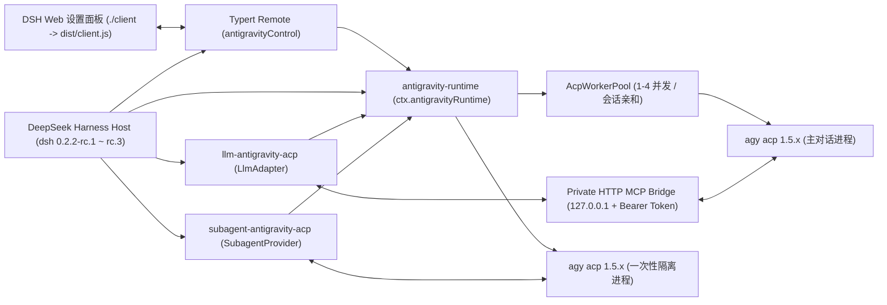

<div align="center">

# dsh-antigravity-acp

**面向 DeepSeek Harness (`dsh`) 的双模式 Antigravity ACP (`agy` CLI 1.5.x) 插件套件**

同时暴露 **`LlmAdapter`（主模型 + 私有 MCP 工具桥）** 与 **`SubagentProvider`（自主外部子 Agent）**，共享同一套托管二进制、隔离凭证、连接池与配额引擎。

[](LICENSE)
[](https://nodejs.org/)
[](https://github.com/deepseek-ai/deepseek-harness)
[](https://github.com/deepseek-ai/cordis)
[-f59e0b.svg)](https://agentclientprotocol.com/)

[架构总览](#架构总览) · [双模式对比](#双模式对比) · [快速安装](#快速安装) · [DSH 设置菜单](#dsh-设置菜单) · [接线配置](#与-deepseek-aidshtool-subagent-接线) · [独立 CLI](#独立-cli-使用) · [配置参考](#配置项参考) · [故障排查](#错误码与故障排查)

</div>

---

## 核心特性

本插件借鉴 [T3 Code](https://github.com/pingdotgg/t3code) 的 `agy` CLI 1.5.x 运行时与鉴权架构，基于 **Cordis `4.1.0`** 与 **`@agentclientprotocol/sdk` `1.4.0`** 为 DeepSeek Harness 提供完整整合：

- **双模式协同，一份基础设施**：通过 [`cordis.patch.yml`](./cordis.patch.yml) 注入共享服务 `antigravity-runtime`（`ctx.antigravityRuntime`），同时驱动主模型适配器（`./llm`）与独立子 Agent（`./subagent`）。
- **新版 `agy` CLI 1.5.x 运行时管理**：
  - 按 `binaryPath` 手动指定 → 托管缓存 → 本机 `PATH` (`agy` / `antigravity`) → 官方更新源自动下载（带 **SHA-512 校验** 与跨进程原子发布锁）四级优先级解析可执行文件，要求版本 `>= 1.5.0`。
  - 自动隔离 `GEMINI_HOME` 与临时解包目录（Windows 短路径友好、并发写锁 + 重试），清理父进程环境变量防止串号。
  - `oauth-personal` 模式下注入 `SSH_CONNECTION` 与 `AGY_ACP_FORCE_FILE_STORAGE=1`，避免 `agy` CLI 1.5 写入全局系统 Keyring 导致多账号覆盖。
- **4 种鉴权方式 + 无头终端登录**：支持 `oauth-personal`、`oauth-business`、`gemini-api-key`、`agent-platform`，以及本地 loopback OAuth 与 `agy acp --login` 授权码粘贴（适合 SSH / 远程环境）；自动剥离 `stdout` OAuth 引导文本防止污染 JSON-RPC NDJSON 流。
- **原生 ACP 1.5.x 协议能力**：支持 `_meta.antigravity.systemPrompt.append` 追加系统提示、独立 `thought_level` 推理强度发现、多模态图片输入（可选注入 `ctx.get('attachments')`）与会话级前缀增量复用（`SessionReuseTracker`）。
- **主模型模式严守 DSH 工具边界**：禁用 ACP `fs` / `terminal`，通过 `127.0.0.1:0` 随机端口 + 32 字节随机 Bearer Token 的私有 Streamable HTTP MCP Bridge 将 DSH 工具暴露给模型，支持并发与多轮工具挂起/续传；一切绕过 Bridge 的 Antigravity 原生工具调用都会被立即拦截并报错 `AGY_NATIVE_TOOLS_BLOCKED`。
- **DSH 图形化设置面板（`设置 -> Antigravity ACP`）**：通过纯浏览器入口 `./client`（`dist/client.js`）与宿主 Typert Remote 服务 `antigravityControl` 联动，直接在 DSH UI 中完成 CLI 一键安装/取消、`binaryPath`/`autoDownload`/代理配置、OAuth 登录（授权码 / 本地回调）或 API Key 鉴权，以及模型列表与配额实时检查。
- **开箱即用的独立 CLI**：自带 `node:child_process` 轻量 `SubprocessRuntime` 实现，无需预先挂载 DSH 宿主即可完成 `install`、`login`、`models`、`quota` 与 `doctor` 诊断。

---

## 架构总览



### 包导出与服务入口

| 导出路径 / 服务名 | 产物位置 | 运行端 | 说明 |
| --- | --- | --- | --- |
| `.` (`dsh-antigravity-acp`) | `dist/index.js` | Node 宿主 | 注册共享服务 `antigravityRuntime`，并在检测到 `typert` 时按需挂载 `antigravityControl` Remote 控制服务 |
| `./llm` (`dsh-antigravity-acp/llm`) | `dist/llm-plugin.js` | Node 宿主 | 注册主模型 `LlmAdapter`（含私有 HTTP MCP Bridge）并响应运行时变更刷新模型列表 |
| `./subagent` (`dsh-antigravity-acp/subagent`) | `dist/subagent-plugin.js` | Node 宿主 | 注册外部隔离 `SubagentProvider` |
| `./client` (`dsh-antigravity-acp/client`) | `dist/client.js` | Web 浏览器 | 纯浏览器插件（`dsh.client.platform: "web"`），注入 `['slots', 'remote']`，挂载 `antigravityControl` 并注册 `settings.section` 与 `settings.section.icon`（`id: "antigravity-acp"`） |
| `antigravityControl` (`TypertRemoteService`) | `src/remote/control-remote.ts` | Node 宿主 ↔ 浏览器 | 暴露 `status`、`installCli`、`installCancel`、`saveConfig`、`authStart`、`authSubmitCode`、`authCancel`、`logout`、`refreshModels`、`refreshQuota` 共 10 个严格 Codec RPC 方法 |

---

## 双模式对比

| 维度 | LLM 模式 (`dsh-antigravity-acp/llm`) | Subagent 模式 (`dsh-antigravity-acp/subagent`) |
| --- | --- | --- |
| DSH 扩展接口 | `ctx.llm`（继承 `LlmAdapter`） | `ctx.subagents`（实现 `SubagentProvider`） |
| 进程模型 | 共享 `AcpWorkerPool`（1–4 并发、会话亲和、空闲回收） | 每次 `start()` 派生独立一次性 `agy acp` 进程 |
| 工具控制权 | **DSH 完全接管**：禁用 ACP `fs`/`terminal`，仅放行私有 MCP Bridge 调用；原生工具命中即触发 `AGY_NATIVE_TOOLS_BLOCKED` | **Antigravity 自主执行**：不挂载 MCP Bridge（`mcpServers: []`），由子进程内 Antigravity Agent Loop 自主调用自身工具 |
| DSH 工具协作 | 支持单次、并行及多轮 `tools/call` 挂起并在同一 ACP Prompt 内回填续跑 | 不暴露父会话 DSH 工具 |
| 权限处理 | 仅自动放行来自受信任 `dsh_tools` Bridge 的请求，其余一律拒绝并取消轮次 | 按 `permissionMode`（`default` / `auto_edit` / `auto` / `yolo`）与 `permissionFallback` 决策 |
| 上下文策略 | 基于 `SessionReuseTracker` 校验 SHA-256 前缀并增量续传；变更或压缩时自动重建 | `inheritsParentContext: false`，仅接收当前委派任务 Prompt |

---

## 快速安装

### 环境要求

- **Node.js**：`>= 22.19`
- **DeepSeek Harness**：支持 **`0.2.2-rc.1`** 至 **`0.2.2-rc.3`**（`peerDependencies` 声明为 `>=0.2.2-rc.1 <0.3.0-0`；开发与类型基线为 `0.2.2-rc.3`）
- **Cordis**：`@deepseek-ai/cordis` `>= 4.0.4 < 5`（开发基线 `4.1.0`）

> [!NOTE]
> 本仓库已包含预编译好的 `dist/` 目录与 [`cordis.patch.yml`](./cordis.patch.yml)，通过 GitHub 安装时**无需本地 TypeScript 编译环境**。

### 方式 1：DSH Desktop 插件管理器安装

在 DSH 桌面端打开 **Plugins / 插件管理**，输入仓库地址即可安装：

```text
https://github.com/qq1299235059/dsh-antigravity-acp
```

### 方式 2：通过 `dsh plugin` CLI 安装

```bash
# 安装到指定 profile（例如 web）
dsh plugin --profile web add git+https://github.com/qq1299235059/dsh-antigravity-acp.git
```

安装完成后，建议**完全退出并重启 DSH**（Desktop 进程热运行期间可能保留旧插件模块缓存）。

### 方式 3：本地源码打包安装（开发/离线）

```bash
git clone https://github.com/qq1299235059/dsh-antigravity-acp.git
cd dsh-antigravity-acp
npm ci
npm run check
npm pack
dsh plugin --profile web add /path/to/dsh-antigravity-acp-0.1.0.tgz
```

### 首次初始化与登录

如果你的机器尚未安装 `agy` CLI（`>= 1.5.0`），或希望使用独立隔离登录态，可直接运行内置 CLI（也可跳过安装，由首次调用时按 `autoDownload: true` 自动拉取）：

```bash
# 1. 解析或下载官方 agy CLI 并做 SHA-512 校验
npx dsh-antigravity-acp install

# 2. 登录隔离 profile（无桌面/SSH 环境建议加 --code 粘贴授权码）
npx dsh-antigravity-acp login --code

# 3. 全面检查环境、二进制版本、鉴权、代理与 ACP 握手
npx dsh-antigravity-acp doctor
```

**可执行文件解析优先级**：
1. 显式配置 `binaryPath`（`configured`，文件名须为 `agy` / `antigravity`）
2. 插件托管缓存（`cached`，位于 `<cacheDir>/tools/antigravity-acp/<platform>-<arch>`）
3. 系统 `PATH` 中的本机 `agy` / `antigravity`（`path`）
4. 当 `autoDownload: true` 时从官方更新源下载并校验 SHA-512（`downloaded`）

---

## DSH 设置菜单

安装并重启 DSH 后，打开左下角 **设置 -> Antigravity ACP** 即可在图形界面中完成全部初始化与日常管理（由 `./client` 浏览器模块通过 `antigravityControl` Typert Remote 服务驱动；无 `typert` 的无头/CLI Profile 不受影响）：

1. **Antigravity CLI 运行时与一键安装**
   - 查看当前安装状态（`已安装` / `未安装` / `安装中`）、解析命令路径、来源（`configured` / `cached` / `path` / `downloaded`）、版本号与隔离配置目录。
   - 点击 **安装 / 更新 Antigravity CLI** 一键下载并校验官方托管版 `agy` CLI；运行期间每 1.5 秒自动轮询进度并可随时点击 **取消安装**。
   - 若此前设置了自定义 `binaryPath`，界面会提示并提供 **安装托管版 CLI 并切换**，一键清除 `binaryPath` 并安装托管版本。
   - 可直接编辑并保存 `binaryPath`、`autoDownload`、`proxyUrl` 与 `proxyBypass`（非密钥配置持久化到 `<profileDir>/ui-config.json` 并热更新连接池）。
2. **OAuth 与鉴权配置**
   - 查看实时登录状态、已登录账号与当前鉴权模式，并可在 4 种模式间切换：
     - `oauth-personal`（Google 个人账号 OAuth — 推荐）
     - `oauth-business`（Google 企业 / GCP OAuth，支持填写 `gcpProject` 与 `gcpLocation`）
     - `gemini-api-key`（Gemini API Key）
     - `agent-platform`（Agent Platform API Key）
   - OAuth 模式提供 **授权码登录（推荐）**（展示授权链接、`打开授权页面`、`复制授权链接` 及授权码/回调 URL 粘贴提交）与 **本地回调登录**，支持随时 **取消登录** 与 **退出登录**。
   - API Key 模式提供密码输入框、**保存并验证 API Key** 与 **清除 Key**（密钥独立保存于 `<profileDir>/ui-secrets.json`，`status` 快照仅返回 `hasApiKey` 布尔标记而绝不回传明文密钥）。
3. **模型与配额**
   - 一键 **刷新模型列表** 查看已发现模型的名称、ID、默认模型标记及支持的 `thinkingOptions` 推理档位。
   - 一键 **刷新配额** 查看各个配额窗口的剩余百分比进度条、账号/档位信息与重置时间。

---

## 与 `@deepseek-ai/dsh-tool-subagent` 接线

`package.json` 的 `"dsh": { "bundle": { "patch": "./cordis.patch.yml" } }` 会在安装时插入三个插件行：

```yaml
- insert:
    - id: antigravity-runtime
      name: dsh-antigravity-acp
      inject: [subprocess]
    - id: llm-antigravity-acp
      name: dsh-antigravity-acp/llm
      inject: [llm, antigravityRuntime]
    - id: subagent-antigravity-acp
      name: dsh-antigravity-acp/subagent
      inject: [subagents, antigravityRuntime]
```

由于 `AntigravitySubagentProvider` 是**进程外（out-of-process）**外部执行器，其 `capabilities` 声明为 `NO_START_CAPABILITIES`（`agentOptions: false`、`agentPreset: false`、`outputSchema: false`、`depthLimit: false`）。因此通过 `@deepseek-ai/dsh-tool-subagent` 将 `antigravity` 暴露为主模型可用工具时，**必须配置 `maxDepth: provider-managed`**：

```yaml
plugins:
  antigravity-runtime:
    authMethod: oauth-personal
    maxConcurrentSessions: 2

  llm-antigravity-acp:
    providerId: antigravity-acp
    providerName: Antigravity ACP

  subagent-antigravity-acp:
    providerName: antigravity
    permissionMode: auto_edit
    permissionFallback: reject

  tool-subagent:
    provider: antigravity
    toolName: antigravity_agent
    maxDepth: provider-managed
```

> [!IMPORTANT]
> Cordis `4.1.0` 的 `inject` 仅接受服务名数组（如 `['llm', 'antigravityRuntime']`），不支持 `{ required, optional }` 写法；可选服务 `attachments` 在插件内部通过 `ctx.get('attachments')` 动态获取。同时三个入口均采用严格命名导出（无 `export default`），以确保 DSH Cordis Loader 正确识别依赖元数据。

如果只需要单模式，在 Profile 中仅保留 `antigravity-runtime` 与 `./llm` 或 `./subagent` 其一即可。

---

## 独立 CLI 使用

插件自带可执行命令 `dsh-antigravity-acp`：

```bash
dsh-antigravity-acp <command> [options]
```

| 子命令 | 说明 |
| --- | --- |
| `status` | 查看可执行文件来源与版本、隔离 `profileDir`、登录态与连接池状态 |
| `install` | 解析或自动下载并验证受支持的官方 `agy` CLI（`>= 1.5.0`） |
| `login [--code\|--loopback]` | 完成隔离 profile 认证（`--code` 走 stdin 粘贴授权码；`--loopback` 走本机回调；`--no-open` 不自动拉起浏览器） |
| `logout` | 清除本地保存的 OAuth 凭证并回收连接池 Worker |
| `models [--refresh]` | 探测并列出可用模型、上下文容量与 `thought_level` 推理档位 |
| `quota` | 通过 Cloud Code Assist 探测当前账号配额窗口与重置时间 |
| `doctor [--strict]` | 执行 Node 版本、二进制、鉴权、代理 URL、ACP `initialize` 握手全链路自检 |
| `help`, `--help`, `-h` | 显示帮助文本 |

### 常用选项

- `--profile-dir <dir>`：覆写隔离 profile 目录
- `--cache-dir <dir>`：覆写托管 CLI 缓存目录
- `--binary-path <path>`：显式指定 `agy` / `antigravity` 可执行文件
- `--auth-method <method>`：`oauth-personal` \| `oauth-business` \| `gemini-api-key` \| `agent-platform`
- `--api-key <key>`：显式传入 API Key
- `--gcp-project <id>` / `--gcp-location <loc>`：Google Cloud Project 与 Location
- `--proxy-url <url>` / `--proxy-bypass <list>`：出站代理与 `NO_PROXY` 列表
- `--cwd <dir>`：指定 `models` / `doctor` 握手使用的工作目录
- `--no-auto-download`：禁止自动下载托管二进制
- `--strict`：`doctor` 遇到可选警告时也返回非零退出码
- `--json`：输出结构化 JSON

---

## 配置项参考

### 1. `antigravity-runtime` (`RuntimeConfigSchema`)

| 配置项 | 类型 | 默认值 | 说明 |
| --- | --- | --- | --- |
| `authMethod` | `'oauth-personal' \| 'oauth-business' \| 'gemini-api-key' \| 'agent-platform'` | `'oauth-personal'` | 鉴权方式 |
| `apiKey` | `string` | `undefined` | 显式 API Key（`gemini-api-key` / `agent-platform`） |
| `apiKeyEnv` | `string` | `undefined` | 读取 API Key 的环境变量名 |
| `gcpProject` | `string` | `undefined` | Google Cloud Project ID（企业 / Vertex AI） |
| `gcpLocation` | `string` | `undefined` | Google Cloud Location / Region |
| `binaryPath` | `string` | `undefined` | 显式指定 `agy` / `antigravity` 路径 |
| `autoDownload` | `boolean` | `true` | 缺失本地可执行文件时是否自动下载并校验 SHA-512 |
| `cacheDir` | `string` | `undefined` | 托管运行时缓存目录 |
| `profileDir` | `string` | `undefined` | 隔离 profile 目录（不污染用户默认 `~/.gemini`） |
| `proxyUrl` | `string` | `undefined` | 出站代理（支持 `http:`、`https:`、`socks4:`、`socks4a:`、`socks5:`、`socks5h:`） |
| `proxyBypass` | `string` | `undefined` | 逗号分隔的代理绕过域名列表 |
| `extraArgs` | `string[]` | `[]` | 启动 `agy acp` 附加的额外参数 |
| `maxConcurrentSessions` | `number (1–4)` | `2` | `AcpWorkerPool` 最大并发租约数 |
| `queueTimeoutMs` | `number` | `120000` | 等待空闲 Worker 租约超时（毫秒） |
| `handshakeTimeoutMs` | `number` | `120000` | 进程冷启动与 `initialize` 握手超时（毫秒） |
| `requestTimeoutMs` | `number` | `30000` | 短控制请求超时（毫秒） |
| `authTimeoutMs` | `number` | `300000` | 交互式登录超时（毫秒） |
| `promptTimeoutMs` | `number` | `1800000` | 单轮 ACP `session/prompt` 最大时长（毫秒） |
| `idleRecycleMs` | `number` | `300000` | 空闲 Worker 回收延迟（毫秒，`0` 表示不自动回收） |
| `autoWarmup` | `boolean` | `false` | 服务启动后是否在后台非阻塞预热二进制与模型目录 |

### 2. `llm-antigravity-acp` (`LlmPluginConfigSchema`)

| 配置项 | 类型 | 默认值 | 说明 |
| --- | --- | --- | --- |
| `providerId` | `string` | `'antigravity-acp'` | 注册到 `ctx.llm` 的 route ID |
| `providerName` | `string` | `'Antigravity ACP'` | 选择器显示名称 |
| `defaultModel` | `string` | `undefined` | 未显式指定模型时的默认模型 ID |
| `contextWindow` | `number` | `128000` | 上游未提供上下文容量时的默认值 |
| `reuseSessions` | `boolean` | `true` | 历史前缀严格递增时复用 ACP 会话并仅发送增量 |
| `ignoreUnsupportedOptions` | `boolean` | `true` | 收到 `temperature` / `maxTokens` / `stop` 时忽略并记录警告，为 `false` 则报错 `UNSUPPORTED_OPTION` |
| `toolTimeoutMs` | `number` | `300000` | MCP Bridge 等待 DSH 执行工具并返回结果的超时（毫秒） |
| `bridgeParkSettleMs` | `number` | `50` | 并行 `tools/call` 聚合并发窗口（毫秒） |
| `maxPromptBytes` | `number` | `1000000` | 单轮序列化 Prompt 最大字节预算（超限时先裁剪历史旧轮） |
| `modelOverrides` | `Record<string, ModelOverrideConfig>` | `{}` | 按模型 ID 覆写 `name`、`description`、`contextWindow`、`defaultMaxTokens`、`inputModalities`、`defaultThoughtLevel` |

### 3. `subagent-antigravity-acp` (`SubagentPluginConfigSchema`)

| 配置项 | 类型 | 默认值 | 说明 |
| --- | --- | --- | --- |
| `providerName` | `string` | `'antigravity'` | 注册到 `ctx.subagents` 的名称 |
| `permissionMode` | `'default' \| 'auto_edit' \| 'auto' \| 'yolo'` | `'default'` | 权限策略：`yolo` 全部允许；`auto_edit` 自动允许读/搜/改；`auto` / `default` 交由回退策略 |
| `permissionFallback` | `'reject' \| 'cancel'` | `'reject'` | 非自动放行请求的处理方式（拒绝单次或取消） |
| `defaultModel` | `string` | `undefined` | 子 Agent 默认模型 ID |
| `defaultThoughtLevel` | `string` | `undefined` | 子 Agent 默认推理档位 |
| `systemPromptAppend` | `string` | `undefined` | 通过 `_meta.antigravity.systemPrompt.append` 追加的系统提示词 |
| `disposeEofGraceMs` | `number` | `6000` | 取消或结束后等待子进程 EOF 退出的宽限（毫秒） |
| `disposeGraceMs` | `number` | `3000` | 终止信号升级强杀宽限（毫秒） |

---

## 错误码与故障排查

| 错误码 | 含义与处理建议 |
| --- | --- |
| `AGY_NOT_INSTALLED` | 未找到 `agy` CLI 且未开启 `autoDownload`，或 `binaryPath` 指向非 `agy`/`antigravity` 可执行文件；运行 `dsh-antigravity-acp install` 或检查路径 |
| `AGY_INSTALL_FAILED` | 官方 manifest 下载、解压或 SHA-512 校验失败；检查网络连接、代理设置与磁盘剩余空间 |
| `AGY_VERSION_UNSUPPORTED` | 检测到的 `agy` 版本低于 `1.5.0`；请升级官方 CLI 或移除旧版手动覆盖路径 |
| `AGY_AUTH_REQUIRED` | 隔离 profile 尚未完成登录或凭证已失效；运行 `dsh-antigravity-acp login --code` 重新认证 |
| `AGY_NATIVE_TOOLS_BLOCKED` | LLM 模式下模型尝试调用 Antigravity 原生工具而非 `dsh_tools` MCP Bridge，已被安全边界阻断 |
| `AGY_TOOL_TIMEOUT` | MCP Bridge 等待 DSH 执行工具超过 `toolTimeoutMs` |
| `AGY_TOOL_RESULTS_MISSING` | 工具续传回合缺少与挂起调用对应的 `ToolResultMessage` |
| `AGY_TOOL_CATALOG_INVALID` | 工具目录超过 256 个、单工具超过 128 KiB 或 JSON Schema 非法 |
| `AGY_SESSION_LIMIT` | 并发挂起工具调用数超过 64 上限或并发排队请求溢出 |
| `AGY_PROXY_INVALID` | `proxyUrl` 格式或协议不受支持 |
| `AGY_ACCOUNT_SUSPENDED` | 上游返回账号停用或服务条款受限 |

---

## 本地开发与验证

```bash
# 类型检查
npm run typecheck

# 构建 dist/
npm run build

# 运行全量单元与双模式集成测试（内置 fake-agy-server.mjs，无需真实账号）
npm test

# 预览 npm 打包文件清单
npm pack --dry-run
```

---

## 安全边界与声明

- **协议与安全约束**：所有错误对象、诊断信息与 `SubagentResult.diagnostic` 均经过 `redactSensitiveText` 脱敏（剔除 Bearer Token、API Key、OAuth `code`/`state`、Google 登录链接及代理密码）；`LlmAdapter` 的协议禁用 `fs`/`terminal` 能力**属于协议层边界而非操作系统沙箱**。
- **第三方软件说明**：本插件在 MIT 协议下开源，属于独立的社区集成实现（并非 Google 或 DeepSeek 官方产品）；运行时按需从 Google 官方渠道下载的 `agy` CLI 适用其各自的第三方条款与许可，不随本代码仓库分发。
- **致谢**：核心 `agy` CLI 1.5.x 下载校验、隔离配置、`SSH_CONNECTION` 凭据隔离及 ACP 适配设计参考了 [`pingdotgg/t3code`](https://github.com/pingdotgg/t3code)。

---

## 开源协议

[MIT License](./LICENSE) © 2026 ailipi (`qq1299235059`)
