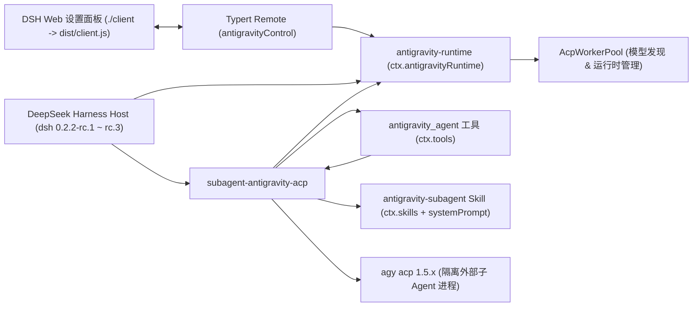

<div align="center">

# dsh-antigravity-acp

**面向 DeepSeek Harness (`dsh`) 的 Antigravity ACP (`agy` CLI 1.5.x) Subagent 插件套件**

为当前 DSH 会话模型提供开箱即用的 **`antigravity_agent` Subagent 工具**、**`antigravity-subagent` 上下文 Skill**，以及可视化的 **DSH 设置面板（模型选择 / 权限策略 / OAuth 鉴权 / CLI 管理 / 插件更新）**。

> [!NOTE]
> 为规避直接将 Antigravity 接入主模型 Provider 引发 Google ToS / 风控报错（如异常 429 限流），插件已移除主 `LlmAdapter`（`./llm`）直连模式，专注于更安全、可控的 **Subagent 工具调用形式**。

[](LICENSE)
[](https://nodejs.org/)
[](https://github.com/deepseek-ai/deepseek-harness)
[](https://github.com/deepseek-ai/cordis)
[-f59e0b.svg)](https://agentclientprotocol.com/)

[架构总览](#架构总览) · [快速安装](#快速安装) · [DSH 设置菜单](#dsh-设置菜单) · [主模型如何调用](#主模型如何调用) · [独立 CLI](#独立-cli-使用) · [配置参考](#配置项参考) · [故障排查](#错误码与故障排查)

</div>

---

## 核心特性

本插件借鉴 [T3 Code](https://github.com/pingdotgg/t3code) 的 `agy` CLI 1.5.x 运行时与鉴权架构，基于 **Cordis `4.1.0`** 与 **`@agentclientprotocol/sdk` `1.4.0`** 为 DeepSeek Harness 提供完整整合：

- **直接暴露为工具 + Skill，零配置即用**：[`cordis.patch.yml`](./cordis.patch.yml) 自动注入 `antigravity-runtime` 与 `subagent-antigravity-acp`，除在 `ctx.subagents` 注册外部 `SubagentProvider`（`antigravity`）外，还会自动向主会话模型注入：
  - **`antigravity_agent` 工具**（`ctx.tools`）：当前 DSH 主模型可直接调用 Antigravity 子 Agent 执行代码分析、搜索、实现或复核任务，并在本回合内拿回完整输出。
  - **`antigravity-subagent` Skill**（`ctx.skills`）与轻量系统提示（`ctx.systemPrompt`）：帮助主模型快速识别何时委派任务、自动读取已配置的模型与使用规范。
- **DSH 图形化 Subagent 配置面板（`设置 -> Antigravity ACP`）**：
  - 支持从已发现模型下拉选择，或直接输入自定义 `defaultModel`、`defaultThoughtLevel`（支持点击模型支持的思考强度标签）、`permissionMode`（`default` / `auto_edit` / `auto` / `yolo`）、`permissionFallback` 与 `systemPromptAppend`，并在模型列表卡片提供一键 **“设为 Subagent 模型”** 按钮。
  - 配置原子持久化至 `<profileDir>/ui-config.json` 并热通知运行时，**下一次工具调用立即生效**，无需重启 DSH。
- **新版 `agy` CLI 1.5.x 运行时与隔离凭证管理**：
  - 按 `binaryPath` 手动指定 → 托管缓存 → 本机 `PATH` (`agy` / `antigravity`) → 官方更新源自动下载（带 **SHA-512 校验** 与跨进程原子发布锁）四级优先级解析可执行文件，要求版本 `>= 1.5.0`。
  - 自动隔离 `GEMINI_HOME` 与临时解包目录，注入 `SSH_CONNECTION` 与 `AGY_ACP_FORCE_FILE_STORAGE=1` 防止 `oauth-personal` 模式写入系统 Keyring 造成串号。
- **4 种鉴权方式 + 无头终端登录**：支持 `oauth-personal`、`oauth-business`、`gemini-api-key`、`agent-platform`，以及授权码粘贴与本地 loopback 回调登录；内置检查更新与在线升级。
- **开箱即用的独立 CLI**：自带轻量 `SubprocessRuntime` 实现，无需挂载 DSH 宿主即可完成 `install`、`login`、`models`、`quota`、`check-update` 与 `doctor`。

---

## 架构总览



### 包导出与服务入口

| 导出路径 / 服务名 | 产物位置 | 运行端 | 说明 |
| --- | --- | --- | --- |
| `.` (`dsh-antigravity-acp`) | `dist/index.js` | Node 宿主 | 注册共享服务 `antigravityRuntime`（含 UI 覆盖热加载）并在检测到 `typert` 时挂载 `antigravityControl` Remote 控制服务 |
| `./subagent` (`dsh-antigravity-acp/subagent`) | `dist/subagent-plugin.js` | Node 宿主 | 注册隔离外部 `SubagentProvider`（`antigravity`）、`antigravity_agent` 工具、`antigravity-subagent` Skill 及系统提示片段 |
| `./client` (`dsh-antigravity-acp/client`) | `dist/client.js` | Web 浏览器 | 纯浏览器插件（`dsh.client.platform: "web"`），注入 `['slots', 'remote']`，挂载 `antigravityControl` 并注册 `settings.section` 与 `settings.section.icon`（`id: "antigravity-acp"`） |
| `antigravityControl` (`TypertRemoteService`) | `src/remote/control-remote.ts` | Node 宿主 ↔ 浏览器 | 暴露 `status`、`installCli`、`installCancel`、`saveConfig`、`saveSubagentConfig`、`authStart`、`authSubmitCode`、`authCancel`、`logout`、`refreshModels`、`refreshQuota`、`checkUpdate`、`updatePlugin`、`cancelPluginUpdate` 共 14 个严格 Codec RPC 方法 |

---

## 快速安装

### 环境要求

- **Node.js**：`>= 22.19`
- **DeepSeek Harness**：支持 **`0.2.2-rc.1`** 至 **`0.2.2-rc.3`**（`peerDependencies` 声明为 `>=0.2.2-rc.1 <0.3.0-0`；开发与类型基线为 `0.2.2-rc.3`）
- **Cordis**：`@deepseek-ai/cordis` `>= 4.0.4 < 5`（开发基线 `4.1.0`）

> [!NOTE]
> 本仓库已包含预编译好的 `dist/` 目录与 [`cordis.patch.yml`](./cordis.patch.yml)，通过 GitHub 安装时**无需本地 TypeScript 编译环境**。

### 方式 1：DSH Desktop 插件管理器安装

在 DSH 桌面端打开 **Plugins / 插件管理**，输入仓库地址即可安装：

```text
https://github.com/qq1299235059/dsh-antigravity-acp
```

### 方式 2：通过 `dsh plugin` CLI 安装

```bash
# 安装到指定 profile（例如 web）
dsh plugin --profile web add git+https://github.com/qq1299235059/dsh-antigravity-acp.git
```

安装完成后，建议**完全退出并重启 DSH**（Desktop 进程热运行期间可能保留旧插件模块缓存）。

### 方式 3：本地源码打包安装（开发/离线）

```bash
git clone https://github.com/qq1299235059/dsh-antigravity-acp.git
cd dsh-antigravity-acp
npm ci
npm run check
npm pack
dsh plugin --profile web add /path/to/dsh-antigravity-acp-0.3.0.tgz
```

### 首次初始化与登录

如果你的机器尚未安装 `agy` CLI（`>= 1.5.0`），或希望使用独立隔离登录态，可在 **DSH 设置面板** 完成，也可运行内置 CLI：

```bash
# 1. 解析或下载官方 agy CLI 并做 SHA-512 校验
npx dsh-antigravity-acp install

# 2. 登录隔离 profile（无桌面/SSH 环境建议加 --code 粘贴授权码）
npx dsh-antigravity-acp login --code

# 3. 全面检查环境、二进制版本、鉴权、代理与 ACP 握手
npx dsh-antigravity-acp doctor
```

---

## DSH 设置菜单

安装并重启 DSH 后，打开左下角 **设置 -> Antigravity ACP** 即可在图形界面中完成全部初始化与日常管理（由 `./client` 浏览器模块通过 `antigravityControl` Typert Remote 服务驱动；无 `typert` 的无头/CLI Profile 不受影响）：

1. **插件版本与更新**
   - 展示当前已安装插件版本与 GitHub 仓库最新版本号 / Commit SHA、提交说明及检查时间，并顺带检测官方 `agy` CLI 更新。
   - 支持 **检查更新**、**立即更新**（通过 DSH 插件管理器拉取最新 Commit）、**取消更新** 与重启提示横幅。
2. **Antigravity CLI 运行时与一键安装**
   - 查看安装状态、命令路径、来源、版本号与隔离配置目录；点击 **安装 / 更新 Antigravity CLI** 自动下载校验托管版 `agy` CLI。
   - 支持配置 `binaryPath`、`autoDownload`、`proxyUrl` 与 `proxyBypass`。
3. **OAuth 与鉴权配置**
   - 支持 `oauth-personal`（推荐）、`oauth-business`（GCP Project/Location）、`gemini-api-key`、`agent-platform`。
   - 提供 **授权码登录（推荐）**（授权页链接、复制、回调 URL 或授权码粘贴提交）与 **本地回调登录**，支持 **取消登录** 与 **退出登录**。
4. **Subagent 配置（工具与模型）**
   - 在已发现模型下拉框中选择模型或手动输入 `defaultModel`（如 `gemini-2.5-pro`、`gemini-3-pro`），指定 `defaultThoughtLevel`（可一键点击当前模型支持的思考强度档位）。
   - 配置 `permissionMode`（`default` / `auto_edit` / `auto` / `yolo`）、`permissionFallback`（`reject` / `cancel`）及可选 `systemPromptAppend` 系统提示追加。
   - 点击 **保存 Subagent 配置** 后原子写入 `<profileDir>/ui-config.json` 并**立即对下一次 `antigravity_agent` 调用生效**。
5. **模型与配额**
   - 一键 **刷新模型列表** 查看已发现模型及其 `thinkingOptions`，每个模型旁可直接点击 **设为 Subagent 模型**。
   - 一键 **刷新配额** 查看账号各配额窗口的剩余进度条与重置倒计时。

---

## 主模型如何调用

安装本插件后，DSH 当前会话的模型（DeepSeek、OpenAI 等任意主模型）无需手动修改 `cordis.patch.yml`，即可自动看到：

1. **工具 `antigravity_agent`**：
   - 参数：`description`（简短任务描述）、`prompt`（自包含完整指令）、`cwd`（可选工作目录）、`model`（可选单次覆盖模型 ID）、`thought_level`（可选单次覆盖思考深度）。
   - 未显式传 `model` / `thought_level` 时自动采用你在 **设置 -> Antigravity ACP -> Subagent** 中配置的模型与权限策略；支持并发多任务调用与随主会话中止信号自动清理子进程。
2. **Skill `antigravity-subagent`**：
   - 挂载了 `@deepseek-ai/dsh-tool-skill` 的预设（`standard` / `ptc` / `cordis`）会在 `<available_skills>` 中看到 `antigravity-subagent`，用户也可直接输入 `/antigravity-subagent` 引导调用。
3. **与原生 `tool-subagent` 兼容**：
   - 若你在高级自定义场景下需要通过 `@deepseek-ai/dsh-tool-subagent` 对接 `provider: antigravity`，仍需为外部提供者配置 `maxDepth: provider-managed`（因为 `AntigravitySubagentProvider` 声明为 `NO_START_CAPABILITIES`）。

[`cordis.patch.yml`](./cordis.patch.yml) 默认注入两行宿主机插件：

```yaml
- insert:
    - id: antigravity-runtime
      name: dsh-antigravity-acp
      inject: [subprocess]
    - id: subagent-antigravity-acp
      name: dsh-antigravity-acp/subagent
      inject: [subagents, antigravityRuntime]
```

> [!IMPORTANT]
> Cordis `4.1.0` 的 `inject` 仅接受必填服务名数组（如 `['subagents', 'antigravityRuntime']`）；可选服务 `tools`、`skills`、`systemPrompt` 与 `attachments` 均在插件内部按需注入，因此本插件在独立精简 / 无头 Profile 下同样安全启动。

---

## 独立 CLI 使用

插件自带可执行命令 `dsh-antigravity-acp`：

```bash
dsh-antigravity-acp <command> [options]
```

| 子命令 | 说明 |
| --- | --- |
| `status` | 查看可执行文件来源与版本、隔离 `profileDir`、登录态与连接池状态 |
| `install` | 解析或自动下载并验证受支持的官方 `agy` CLI（`>= 1.5.0`） |
| `login [--code\|--loopback]` | 完成隔离 profile 认证（`--code` 走 stdin 粘贴授权码；`--loopback` 走本机回调；`--no-open` 不自动拉起浏览器） |
| `logout` | 清除本地保存的 OAuth 凭证并回收连接池 Worker |
| `models [--refresh]` | 探测并列出可用模型、上下文容量与 `thought_level` 推理档位 |
| `quota` | 通过 Cloud Code Assist 探测当前账号配额窗口与重置时间 |
| `check-update` | 检查 GitHub 最新插件版本 / Commit 与官方 `agy` CLI 版本更新 |
| `doctor [--strict]` | 执行 Node 版本、二进制、鉴权、代理 URL、ACP `initialize` 握手全链路自检 |
| `help`, `--help`, `-h` | 显示帮助文本 |

### 常用选项

- `--profile-dir <dir>`：覆写隔离 profile 目录
- `--cache-dir <dir>`：覆写托管 CLI 缓存目录
- `--binary-path <path>`：显式指定 `agy` / `antigravity` 可执行文件
- `--auth-method <method>`：`oauth-personal` \| `oauth-business` \| `gemini-api-key` \| `agent-platform`
- `--api-key <key>`：显式传入 API Key
- `--gcp-project <id>` / `--gcp-location <loc>`：Google Cloud Project 与 Location
- `--proxy-url <url>` / `--proxy-bypass <list>`：出站代理与 `NO_PROXY` 列表
- `--cwd <dir>`：指定 `models` / `doctor` 握手使用的工作目录
- `--no-auto-download`：禁止自动下载托管二进制
- `--strict`：`doctor` 遇到可选警告时也返回非零退出码
- `--json`：输出结构化 JSON

---

## 配置项参考

### 1. `antigravity-runtime` (`RuntimeConfigSchema`)

| 配置项 | 类型 | 默认值 | 说明 |
| --- | --- | --- | --- |
| `authMethod` | `'oauth-personal' \| 'oauth-business' \| 'gemini-api-key' \| 'agent-platform'` | `'oauth-personal'` | 鉴权方式 |
| `apiKey` | `string` | `undefined` | 显式 API Key（`gemini-api-key` / `agent-platform`） |
| `apiKeyEnv` | `string` | `undefined` | 读取 API Key 的环境变量名 |
| `gcpProject` | `string` | `undefined` | Google Cloud Project ID（企业 / Vertex AI） |
| `gcpLocation` | `string` | `undefined` | Google Cloud Location / Region |
| `binaryPath` | `string` | `undefined` | 显式指定 `agy` / `antigravity` 路径 |
| `autoDownload` | `boolean` | `true` | 缺失本地可执行文件时是否自动下载并校验 SHA-512 |
| `cacheDir` | `string` | `undefined` | 托管运行时缓存目录 |
| `profileDir` | `string` | `undefined` | 隔离 profile 目录（不污染用户默认 `~/.gemini`） |
| `proxyUrl` | `string` | `undefined` | 出站代理（支持 `http:`、`https:`、`socks4:`、`socks4a:`、`socks5:`、`socks5h:`） |
| `proxyBypass` | `string` | `undefined` | 逗号分隔的代理绕过域名列表 |
| `extraArgs` | `string[]` | `[]` | 启动 `agy acp` 附加的额外参数 |
| `maxConcurrentSessions` | `number (1–4)` | `2` | `AcpWorkerPool` 最大并发租约数 |
| `queueTimeoutMs` | `number` | `120000` | 等待空闲 Worker 租约超时（毫秒） |
| `handshakeTimeoutMs` | `number` | `120000` | 进程冷启动与 `initialize` 握手超时（毫秒） |
| `requestTimeoutMs` | `number` | `30000` | 短控制请求超时（毫秒） |
| `authTimeoutMs` | `number` | `300000` | 交互式登录超时（毫秒） |
| `promptTimeoutMs` | `number` | `1800000` | 单轮 ACP `session/prompt` 最大时长（毫秒） |
| `idleRecycleMs` | `number` | `300000` | 空闲 Worker 回收延迟（毫秒，`0` 表示不自动回收） |
| `autoWarmup` | `boolean` | `false` | 服务启动后是否在后台非阻塞预热二进制与模型目录 |

### 2. `subagent-antigravity-acp` (`SubagentPluginConfigSchema`)

| 配置项 | 类型 | 默认值 | 说明 |
| --- | --- | --- | --- |
| `providerName` | `string` | `'antigravity'` | 注册到 `ctx.subagents` 的名称 |
| `toolName` | `string` | `'antigravity_agent'` | 注册到 `ctx.tools` 供主模型直接调用的工具名 |
| `permissionMode` | `'default' \| 'auto_edit' \| 'auto' \| 'yolo'` | `'default'` | 权限策略：`yolo` 全部允许；`auto_edit` 自动允许读/搜/改；`auto` / `default` 交由回退策略 |
| `permissionFallback` | `'reject' \| 'cancel'` | `'reject'` | 非自动放行请求的处理方式（拒绝单次或取消） |
| `defaultModel` | `string` | `undefined` | 子 Agent 默认模型 ID（可在设置 UI 中实时覆写） |
| `defaultThoughtLevel` | `string` | `undefined` | 子 Agent 默认推理档位（可在设置 UI 中实时覆写） |
| `systemPromptAppend` | `string` | `undefined` | 通过 `_meta.antigravity.systemPrompt.append` 追加的系统提示词 |
| `disposeEofGraceMs` | `number` | `6000` | 取消或结束后等待子进程 EOF 退出的宽限（毫秒） |
| `disposeGraceMs` | `number` | `3000` | 终止信号升级强杀宽限（毫秒） |

---

## 错误码与故障排查

| 错误码 | 含义与处理建议 |
| --- | --- |
| `AGY_NOT_INSTALLED` | 未找到 `agy` CLI 且未开启 `autoDownload`，或 `binaryPath` 指向非 `agy`/`antigravity` 可执行文件；运行 `dsh-antigravity-acp install` 或检查路径 |
| `AGY_INSTALL_FAILED` | 官方 manifest 下载、解压或 SHA-512 校验失败；检查网络连接、代理设置与磁盘剩余空间 |
| `AGY_VERSION_UNSUPPORTED` | 检测到的 `agy` 版本低于 `1.5.0`；请升级官方 CLI 或移除旧版手动覆盖路径 |
| `AGY_AUTH_REQUIRED` | 隔离 profile 尚未完成登录或凭证已失效；运行 `dsh-antigravity-acp login --code` 重新认证 |
| `AGY_PROXY_INVALID` | `proxyUrl` 格式或协议不受支持 |
| `AGY_ACCOUNT_SUSPENDED` | 上游返回账号停用或服务条款受限 |

---

## 本地开发与验证

```bash
# 类型检查
npm run typecheck

# 构建 dist/
npm run build

# 运行全量单元与集成测试（内置 fake-agy-server.mjs，无需真实账号）
npm test

# 预览 npm 打包文件清单
npm pack --dry-run
```

---

## 安全边界与声明

- **凭据脱敏与最小权限**：所有错误对象、诊断信息与 `SubagentResult.diagnostic` 均经过 `redactSensitiveText` 脱敏（剔除 Bearer Token、API Key、OAuth `code`/`state`、Google 登录链接及代理密码）；Antigravity Subagent 在独立一次性子进程中运行，并通过 `permissionMode` 与 `permissionFallback` 控制工具授权边界。
- **第三方软件说明**：本插件在 MIT 协议下开源，属于独立的社区集成实现（并非 Google 或 DeepSeek 官方产品）；运行时按需从 Google 官方渠道下载的 `agy` CLI 适用其各自的第三方条款与许可，不随本代码仓库分发。
- **致谢**：核心 `agy` CLI 1.5.x 下载校验、隔离配置、`SSH_CONNECTION` 凭据隔离及 ACP 适配设计参考了 [`pingdotgg/t3code`](https://github.com/pingdotgg/t3code)。

---

## 开源协议

[MIT License](./LICENSE) © 2026 ailipi (`qq1299235059`)
